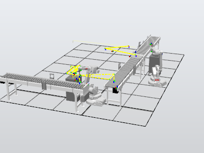

# Box Creator: Industrial Robotics Simulation (ABB RobotStudio)

Simulation of an industrial process called **Box Creator**, built in **ABB RobotStudio** for the Industrial Robotics course at Universidad Carlos III de Madrid (UC3M). The station has **2 ABB IRB 1600 robots, 3 conveyors and 2 working tables**. Both robots are programmed in **RAPID**, and the process is driven by digital I/O signals and RobotStudio **Smart Components**.

## Demo

Full simulation video (about 3 minutes): [`media/Simulation_Work_Of_Industrial_Robotics.mp4`](media/Simulation_Work_Of_Industrial_Robotics.mp4)

## How the process works

**Robot 1** runs a loop (`main`) that checks the station sensors and chooses what to do:

| Condition (digital inputs) | Routine | Action |
|---|---|---|
| Small box on conveyor 1 and working table 1 empty | `SmallBox1` | Picks the small box with the vacuum tool and places it on working table 1 |
| Big box on conveyor 1 and conveyor 2 not full | `BigBoxOG` | Picks the big box and places it on conveyor 2 |
| Small box on conveyor 1, working table 1 occupied and conveyor 2 not full | `Glue` + `SmallBox2CreateNewBig` | Applies glue with the pen tool, places a second small box, and the station creates a new big box that the robot then moves to conveyor 2 |

**Robot 2** takes the big box from conveyor 2, places it on working table 2 and then moves it to conveyor 3 (`take_oc2` and `take_ot2`).

Both robots work in the coordinates of the conveyors and tables (work objects), and approach each pick and place point from above with `Offs` offsets, with `MoveJ` for the long moves and `MoveL` for the final approach.

## Station I/O (robot 1)

| Signal | Type | Meaning |
|---|---|---|
| `SmallCubeConveyor1` | DI | Small box available on conveyor 1 |
| `BigCubeConveyor1` | DI | Big box available on conveyor 1 |
| `Cube1Table` | DI | Box present on working table 1 |
| `BigCubeTable` | DI | Big box present on the working table |
| `FullConveyor2` | DI | Conveyor 2 is full |
| `StopRobFunction` | DI | Stop request |
| `Vacuum` | DO | Vacuum tool on/off |
| `Erase` | DO | Removes the small boxes in the simulation |
| `Create` | DO | Creates the new big box in the simulation |

## Repository contents

| Path | Description |
|---|---|
| `rapid/Robot1_Module1.mod` | RAPID program of robot 1 |
| `rapid/Robot2_Module1.mod` | RAPID program of robot 2 |
| `media/Simulation_Work_Of_Industrial_Robotics.mp4` | Video of the simulation |
| `media/overview.png` | Station preview |

## Note on the station file

The RobotStudio station is not included, because it uses a vacuum and pen tool component provided by the university. The RAPID programs, the I/O signals and the simulation video are included, so the full logic of the process can be reviewed here. The station was built with ABB RobotStudio 2024.4 and RobotWare 6.15.08 (IRB 1600-8/1.45).

## Technologies

- ABB RobotStudio (station design and simulation)
- RAPID (robot programming)
- Smart Components (conveyors, box creation and erasing) and a custom vacuum/pen tool component

## Authors

Team of 2, Industrial Robotics, Universidad Carlos III de Madrid (March-April 2025).

- Erika Santano Martín: [GitHub](https://github.com/esantano1) · [LinkedIn](https://www.linkedin.com/in/esantanomartin/)
- Marta Dominguez Bartolome

